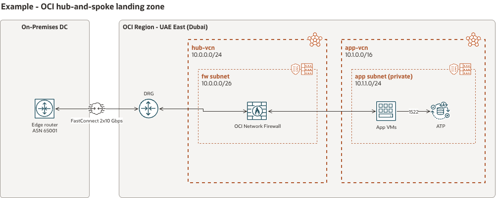

# OCI Architecture Diagrams skill for Claude

A Claude skill that draws Oracle Cloud Infrastructure architecture diagrams in Oracle's own style. Describe the regions, VCNs, subnets, gateways and flows in plain English; Claude returns an editable `.drawio` file and a PNG built from Oracle's official OCI Architecture Diagram Toolkit (v24.2, 232 icons).



## What it does

- Uses Oracle's toolkit icons as-is: no clip-art, no invented icons
- Follows the style guide: region / VCN / subnet groups, badges, FastConnect, VPN and remote peering connectors
- Draws services without an Oracle icon (VMware, Veeam, Palo Alto...) as labelled boxes instead of wrong icons
- Marks missing CIDRs as placeholders and lists its assumptions
- Checks the layout (overlaps, icons outside groups) before rendering

## Setup

1. **Clone or download** this repo.
2. **Add Oracle's toolkit.** Download the draw.io toolkit from [Oracle's OCI Architecture Diagram Toolkits page](https://docs.oracle.com/en-us/iaas/Content/General/Reference/graphicsfordiagrams.htm) and drop it into `oci-architecture-diagrams/toolkit/`. See [toolkit/README.md](oci-architecture-diagrams/toolkit/README.md).
3. **Zip the skill folder**:
   ```bash
   cd oci-architecture-diagrams && zip -r ../oci-architecture-diagrams.zip . && cd ..
   ```
   The zip must contain `SKILL.md` at its top level or inside one folder.
4. **Enable code execution** in Claude (Settings → Capabilities). On Team/Enterprise plans an admin may need to allow skills.
5. **Upload the zip** in Claude's skills settings and turn the skill on.
6. Start a new chat: *"Draw an OCI diagram of..."*

Using Claude Code instead? Copy the `oci-architecture-diagrams` folder (with the toolkit added) into `~/.claude/skills/`.

## Example prompt

> Draw an OCI diagram: UAE East (Dubai) region, hub VCN 10.0.0.0/24 with Network Firewall, app VCN 10.1.0.0/16 with a private app subnet (2 VMs) and a DB subnet (ATP). On-prem connects over 2×10G FastConnect to the DRG.

Also try: *"Convert this diagram to OCI style"* with a screenshot attached, or ask for a *"logical diagram"* for a capability-level view.

## Using the library directly

`scripts/ocidraw.py` works without Claude too (Python 3.8+, standard library only; PNG export needs [draw.io desktop](https://github.com/jgraph/drawio-desktop/releases)):

```bash
export OCI_TOOLKIT=oci-architecture-diagrams/toolkit
python3 oci-architecture-diagrams/scripts/ocidraw.py icons firewall
python3 examples/hub_spoke.py
```

## Licence and trademarks

The code in this repo is MIT licensed (see [LICENSE](LICENSE)). OCI icons, the Architecture Diagram Toolkit and the Oracle name belong to Oracle; download them from Oracle under Oracle's terms. This is an independent community project, not affiliated with or endorsed by Oracle or Anthropic. Views are my own and not those of my current or previous employers.
